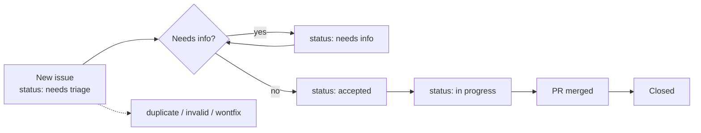

# Contributing to watchducks

🦆 Join the flock. Thanks for helping the ducks keep watch. Keep changes small and focused.

**Want to start now?** Pick an issue labeled [`good first issue`](https://github.com/bassemustafa/watchducks/labels/good%20first%20issue), or jump to [Your first pull request](#your-first-pull-request). Features need an issue first; bug fixes can go straight to a pull request.

## Contents

- [Ways to help](#ways-to-help)
- [Before you start](#before-you-start)
- [How issues flow](#how-issues-flow)
- [Labels](#labels)
- [Development setup](#development-setup)
- [Project layout](#project-layout)
- [Engine rules](#engine-rules)
- [Privacy rules](#privacy-rules)
- [Your first pull request](#your-first-pull-request)
- [Teaching the ducks a new agent CLI](#teaching-the-ducks-a-new-agent-cli)
- [Pull requests](#pull-requests)
- [Releasing](#releasing)
- [License](#license)

## Ways to help

- **Report a bug.** Use the bug report form. Something the ducks got wrong is worth knowing.
- **Suggest a feature.** Use the feature request form and describe the problem first.
- **Teach the ducks a new agent CLI.** The most wanted contribution; see [below](#teaching-the-ducks-a-new-agent-cli).
- **Improve the docs.** Fix a typo, add an example, make a guide clearer.
- **Review pull requests.** A second pair of eyes, especially on privacy, is always welcome.
- **Triage issues.** Reproduce reports, ask for missing details, point out duplicates.

## Before you start

- For a feature, open an issue first and describe the problem. Wait for agreement before you write code.
- Bug fixes can go straight to a pull request. Link the issue if one exists.
- Read [CODE_OF_CONDUCT.md](CODE_OF_CONDUCT.md). All participants are expected to follow it.
- Do not report security problems in issues or pull requests. Follow the process in [SECURITY.md](SECURITY.md), or use the [private advisory form](https://github.com/bassemustafa/watchducks/security/advisories/new).

## How issues flow



Triage rules:

- Every issue gets exactly one `type:` label.
- Every issue gets at least one `area:` label and exactly one `status:` label.
- `priority:` is optional.

## Labels

[`.github/labels.yml`](.github/labels.yml) is the source of truth for the label list. Pull requests get `area:` labels and `type: docs` automatically from the files they change (the labeler, configured in [`.github/labeler.yml`](.github/labeler.yml)). The maintainer sets `type:`, `status:` and `priority:` by hand.

**type**: what kind of change. Exactly one per issue.

| Label | Meaning |
|---|---|
| `type: bug` | Something the ducks got wrong |
| `type: feature` | A new capability or an improvement |
| `type: docs` | README, guides and other docs |
| `type: chore` | CI, tooling, dependencies or refactors with no behaviour change |
| `type: question` | Asking how something works |

**area**: which part of watchducks. At least one per issue.

| Label | Meaning |
|---|---|
| `area: tracking` | Which runs are seen: subagents, relays, agent CLIs, background shells |
| `area: ui` | Sidebar, band, dossier, station board, motion, desktop rendering |
| `area: costs` | Prices, the LiteLLM list, costMode and estimates |
| `area: adapters` | Live numbers: opencode stats and child reports |
| `area: privacy` | Changes what data is read, kept or sent; needs maintainer review |
| `area: platform` | Windows, the desktop app, mobile, VS Code, engine versions |
| `area: tooling` | CI, tests, scripts and releases |
| `area: accessibility` | Barriers for people with disabilities |

**status**: where the issue is in its life. Exactly one at a time.

| Label | Meaning |
|---|---|
| `status: needs triage` | New; a maintainer has not looked yet |
| `status: needs info` | Waiting for details from the reporter |
| `status: accepted` | Agreed; ready for a pull request |
| `status: in progress` | Someone is working on it |
| `status: blocked` | Waiting on something else |

**priority**: optional.

| Label | Meaning |
|---|---|
| `priority: high` | Do this soon |
| `priority: low` | Nice to have |

**community**: signals for contributors.

| Label | Meaning |
|---|---|
| `good first issue` | Small, well-scoped, good for newcomers |
| `help wanted` | The maintainers would welcome a pull request |

**resolution**: why an issue was closed without a fix.

| Label | Meaning |
|---|---|
| `duplicate` | Already reported or proposed |
| `invalid` | Not a watchducks problem, or not reproducible |
| `wontfix` | Out of scope for watchducks |

## Development setup

Requirements: Node 20 or newer for development (CI uses Node 24), and Claude Code 2.1.289 or newer. CI runs the tests on 2.1.289 and 2.1.295; a Button takes only a plain string `label`, because 2.1.289 refuses any other content.

From the repo root:

```sh
npm ci
claude --plugin-dir .    # run Claude Code with the local mod loaded
```

All four gates must pass before you open a pull request:

```sh
claude plugin validate .
npx tsc -p .
claude plugin test .
npm run check:gating
```

Type checking needs the engine's type declarations. Start `claude --plugin-dir .` once: Claude Code writes them into `.claude-plugin/types/`, which is gitignored and never committed. CI has no copy of them, so it does not run `tsc`; run it locally before every pull request.

## Project layout

- `hooks/register.tsx`: plugin entry point.
- `src/`: lifecycle, collectors under `src/collect/`, usage adapters under `src/adapters/`, pure ledger, price, cost, classify and history modules, and UI under `src/ui/`.
- `src/prices-litellm.ts`: the bundled LiteLLM price list. It is generated; do not edit it by hand.
- `types/index.d.ts`: the shared data contract.
- `test/`: engine tests. `test/unit/`: pure tests.
- `scripts/check-gating.mjs`: gating hook check.
- `scripts/update-prices.mjs`: regenerates `src/prices-litellm.ts` from LiteLLM's public price list.
- `test/gating-allowlist.json`: the allow-list of gating hooks that CI checks.

## Engine rules

The mod engine enforces these rules. Breaking one either fails the load or silently skips a hook.

1. Pass the `$` engine handle only to functions declared in the same file. Never pass it to an imported function.
2. Register each event at most once without a matcher. `session.start` and `session.end` live in `src/lifecycle.ts`. `agent.spawn`, `turn.step`, `turn.complete`, `classic.Stop` and `classic.SubagentStop` live in `src/collect/agents.ts`.
3. Declare state atoms in each file that uses them, with the literal plugin and key. Never import them.
4. Engine tests must raise events with their full input shape. To check for skipped hooks, run `claude --debug plugin test . | grep -i skipped`.

## Privacy rules

This is the core promise of the project, and it is not negotiable.

watchducks never reads, copies, displays, logs or stores message content, prompts, tool input or output text, file contents, or error text. It keeps only allow-listed metadata: ids, model, effort, token counts, cost, status, timings and counts. The files it reads are a relay's `result.json` and the numbers-only reports of child Claude sessions. It reads them transiently and keeps only allow-listed fields. With the `opencodeStats` setting on, it runs `opencode stats` with a fixed argument list and keeps only the numbers.

Before you go undercover, check every change that touches collectors against this list:

- [ ] It does not read message, prompt, tool input or output, or file content.
- [ ] It does not add a new content field to the data contract in `types/index.d.ts`.
- [ ] It does not store or log anything beyond allow-listed metadata.
- [ ] It adds no network call. The only one is the daily price list GET in `src/lifecycle.ts`, which sends no data.
- [ ] `test/privacy.test.ts` still passes. Do not weaken or remove the canary test.
- [ ] Any new gating hook is added to `test/gating-allowlist.json`, and the pull request says why. Reviewers check each entry.

## Your first pull request

1. **Fork** the repository and clone your fork.
2. **Branch** with the name `type/short-description`, for example `feat/aider-cli`, `fix/band-width` or `docs/relay-example`.
3. **Make the change, with a test.**
4. **Run the four gates** (see [Development setup](#development-setup)). All must pass.
5. **Update `CHANGELOG.md`** under `## [Unreleased]`.
6. **Commit** in conventional style: `feat(ui): ...`, `fix(collect): ...`, `docs: ...`, `chore: ...`, `test: ...`.
7. **Open the pull request** and fill in the template. Keep one change per pull request.
8. The maintainer reviews and squash-merges.

## Teaching the ducks a new agent CLI

This is the most wanted contribution. Start with the [new agent CLI form](https://github.com/bassemustafa/watchducks/issues/new?template=new_agent_cli.yml), then, if you want to write it yourself:

- The classifier lives in `src/classify.ts`. It recognizes CLI names and picks out flags such as model and effort.
- A new CLI gets its status and duration from the command and its tool result.
- Live numbers need a numbers-only usage source that the CLI exposes, like `opencode stats`.
- Anything that reads data must follow the [Privacy rules](#privacy-rules) and gets `area: privacy` review.
- Add a test in `test/unit/` with the command shapes. Use placeholders instead of real prompts.

## Pull requests

- Keep one change per pull request.
- All four gates must be green.
- Add tests for new behavior.
- Update `CHANGELOG.md` under `## [Unreleased]`.
- Use conventional commit style, for example `feat(ui): ...`, `fix(collect): ...` or `docs: ...`.
- Claude prices come from the built-in table in `src/price.ts`, dated 2026-10-06. Any change to that table needs a source link in the pull request. Prices for other models come from LiteLLM's list; do not edit `src/prices-litellm.ts` by hand.
- Fill in the pull request template.
- The labeler adds `area:` labels (and `type: docs`) from the files you change; you do not need to set them.

## Releasing

For maintainers, before the version bump:

1. Refresh the bundled price list: `node scripts/update-prices.mjs`. It writes `src/prices-litellm.ts` with today's date.
2. Run the four gates. The test `common agent models keep a price in the bundled list` fails when a common model lost its price or moved to another LiteLLM entry; update its list in `test/unit/price-list.test.ts` after checking the new entry.
3. Bump the version in `.claude-plugin/plugin.json`, `package.json` and `package-lock.json`, and move `## [Unreleased]` in `CHANGELOG.md` under the new version.

## License

watchducks is released under the MIT License. See [LICENSE](LICENSE). By contributing, you agree that your contributions are licensed under the MIT License.
