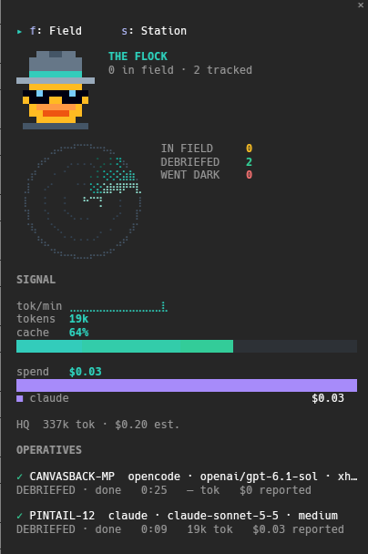
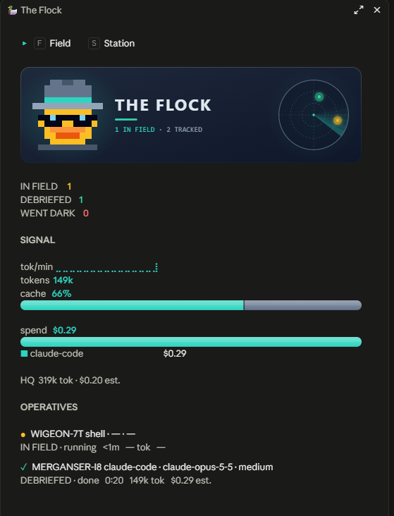

# watchducks

A flock of spy ducks watching every subagent, relay and background run your Claude Code session starts.

[](LICENSE)
[](https://github.com/bassemustafa/watchducks/actions/workflows/ci.yml)

watchducks is an open-source Claude Code mod (a function-hooks plugin). It tracks the work your session hands to other agents: Agent-tool subagents, delegate relay runs, raw implementer CLIs and background shell commands. For each run it shows status, model, effort, tokens, cache use, cost and review outcome. It reads only numbers, identifiers and enums. It never reads your prompts or answers (see [Privacy](#privacy)).

## What you see

**The sidebar** (`/flock`). Top to bottom:

1. **Header:** a pixel-art duck in a fedora and shades, a radar with one blip per running operative, and the title THE FLOCK.
2. **Counters:** IN FIELD, DEBRIEFED and WENT DARK counts. RETURNED and OFF RADAR appear when they are not zero. (Status words are explained in the [Glossary](#glossary).)
3. **Signal:** a tokens-per-minute sparkline for the last 30 minutes, total tokens, a cache hit bar, spend by implementer, and a dim line for HQ (the main loop).
4. **Operative cards:** one two-line card per tracked run (an "operative"). Line 1: status dot, codename, implementer · model · effort. Line 2: elapsed time, tokens and cost, or the review line. Press a card to open its dossier.
5. **Station board:** see below.

A sketch of the layout (not a screenshot; exact glyphs and spacing differ):

```text
  [duck]   THE FLOCK
  [radar]  ● ● ·

  IN FIELD 2 · DEBRIEFED 3 · WENT DARK 1

  tokens/min  ⣀⣤⣶⣿⣷⣤⣀   412k total
  cache       ████████░░░░  61%
  spend       ██████▒▒▒░░   claude ■ opencode ■
  HQ          96k tok · $0.71

  ● GOLDENEYE-7Q   claude · claude-sonnet-5-5 · high
    4m 12s · 88k tok · $0.42 reported

  ● MALLARD-0K     opencode · glm-5 · —
    1m 03s · — · $0 reported

  ● TEAL-3X        claude-code · claude-opus-5-5 · high
    vetted by SMEW-1A · 2 leaks · 5 patches

  STATION BOARD   [Session | 30 days]
  claude × sonnet-5-5   ████████   4 ops  …
```

**The dossier** is the detail view of one operative: codename, kind, agent type, lane, implementer, model or models, effort and where it came from, read-only flag, status, start, end and duration, tokens, cache %, cost with its source, handler reviews, patches and leaks. Tokens show `input` (uncached + cache read + cache write) with those three parts under it, then `output` and `total`. It has a Back button. The Agent call's description is not shown.

**The station board** has one row per implementer × model, with a proportional bar (by cost, or by tokens when cost is unknown). Columns: ops, done, failed, tokens, cache %, cost, vetted/ops, and leaks per vetted op. Each row also shows `in` and `out` totals and, when tokens were measured, the `uncached · read · write` split. This works for both the Session and the 30 days span. Use the **Session | 30 days** toggle to switch between this session and the last 30 days.

**The band** is one line above the prompt. It shows when the sidebar is not shown and a run is in field or one ended in the last 5 minutes:

```text
🦆 FLOCK  ▸ 2 in field · 3 debriefed · 1 dark   412k tok · 61% cache · $1.84   /flock
```

| Terminal | Desktop app |
|---|---|
|  |  |

**Motion** runs only in the terminal sidebar. The status dot of each running card pulses. When a run ends, its card shows a stamp: `✦ DEBRIEFED ✦`, `✕ WENT DARK ✕` or `✕ BURNED ✕`. Token and cost figures count up to their new value over about 0.6 s. The header duck blinks while anything is in field. The desktop app and the band do not animate. The `motion` setting turns all of it off.

## Per run

| Field | Meaning |
|---|---|
| Status | running, done, failed, stopped, ended (outcome unknown), or no signal |
| Implementer | `claude-code` (subagent), `claude`, `opencode`, `codex`, `gemini`, `shell` or `unknown` |
| Model | the model last seen (all of them, for a mixed-model run) |
| Effort | observed, reported by the relay, or taken from a flag |
| Tokens | uncached input, output, cache read, cache write |
| Cache % | cache read ÷ total input (uncached + cache read + cache write) |
| Cost | in USD, marked **reported** (from the relay or `opencode stats`) or **est.** (estimated from tokens; see [Costs](#costs)) |
| Reviews | handler (the reviewer), leaks (bugs found), patches (edit calls) |

**"—"** means the value is not available for that source (for example, tokens for an opencode relay with `opencodeStats` off). **"?"** means the value should exist but is unknown (for example, an unpriced model, or a result.json not read yet). A missing value is never shown as 0.

## Glossary

| Term | Plain meaning |
|---|---|
| operative | a tracked run |
| IN FIELD | running |
| DEBRIEFED | done |
| WENT DARK | failed |
| BURNED | stopped |
| RETURNED | ended, outcome unknown |
| OFF RADAR | no signal |
| handler | reviewer |
| vetted | reviewed (only a recorded verdict counts) |
| leaks | bugs |
| patches | edit calls |
| HQ | the main loop |
| codename | a name for a run, such as `GOLDENEYE-7Q`: a duck species plus a two-character suffix |

## Install

Requires Claude Code 2.1.289 or newer (2.1.289 is the version the Claude desktop app bundles).

In a shell:

```sh
claude plugin install watchducks --marketplace bassemustafa/watchducks
```

Inside Claude Code:

```text
/plugin install watchducks --marketplace bassemustafa/watchducks
```

Pass settings at install with `--config key=value`, for example `--config motion=off`, or change them later from the `/plugin` menu.

The docked sidebar needs the fullscreen layout. Elsewhere the sidebar opens inline and the band is shown.

## Coverage

| Source | Identity | Status | Tokens & cache | Cost |
|---|---|---|---|---|
| Agent-tool subagent | agent type; model and effort seen per request | from the spawn result, turn end and agent list | yes, per request | estimated from tokens (see [Costs](#costs)) |
| `claude` relay | from the command and result.json (`lane`, `model`, `effort`) | from result.json | yes, from result.json `usage`; live from its child report while it runs (see [Live numbers](#live-numbers)) | reported (`totalCostUsd`) |
| `opencode` relay | from the command and result.json (`tool`, `model`, `variant`) | from result.json | — (with `opencodeStats` on: from `opencode stats`) | reported by the relay, or from `opencode stats` with `opencodeStats` on; `$0 reported` under subscription plans |
| `codex` relay | from the command and result.json, when present | from result.json | — | — |
| Other relay scripts (a `relay*` script, or one under a `*delegate*` folder) | from the path, `--tool`, or result.json `tool` (`unknown` until then) | from result.json when its schema is `delegate-relay.result.v<N>`, otherwise from the Bash result only | from result.json when its schema is `delegate-relay.result.v<N>`, otherwise — | from result.json when its schema is `delegate-relay.result.v<N>`, otherwise — |
| Raw CLIs: `codex exec`, `opencode run`, `claude -p`, `gemini -p` | implementer, plus `--model`/`-m` if given literally | tool result (foreground) or background snapshots | — (`opencode run` with `opencodeStats` on: `opencode stats`; `claude -p` with watchducks loaded in it: its child report) | — (same sources as tokens) |
| Other background shell | implementer `shell` | background snapshots | — | — |
| HQ (main loop) | session model | — | yes, per request | estimated; shown separately, never in delegated totals |

> **`--out-dir` is optional.** With it, watchducks reads `<out-dir>/result.json`. Without it, watchducks finds the result itself (discovery). While a relay without an out-dir runs (up to 3 h) and for less than 2 minutes after it ends, it scans the allowed folders about every 9 s and pairs a `result.json` with the run by start time, tool and working directory. The out-dir, or the folder discovery finds, must be under the system temp dir, `/tmp`, the session root or a `relayRoots` entry.

Runs the session did not start are not tracked.

### Live numbers

Numbers while a run is still going, not only when it ends:

| Run | Live numbers |
|---|---|
| Subagent | yes, per request |
| Claude child, however started | yes, about every 5 s (needs watchducks loaded in the child; see [Known limits](#known-limits)) |
| opencode, however started | yes, about every 10 s, when `opencodeStats` is on |
| Relay with `result.json` only | final numbers only |
| codex, gemini | status and elapsed time only |

## Commands and tools

| Command | Effect |
|---|---|
| `/flock` | open the sidebar |
| `/flock station` | open the sidebar on the station board |
| `/flock clear` | remove ended runs from the board; running runs stay; history is unaffected |
| `/flock purge` | delete all stored history |

Keys inside the sidebar: `f` field, `s` station, `h` session / 30 days, `b` back. Tab walks the cards.

Tools Claude can call:

- `mcp__watchducks__roster` lists the session's runs (read-only). Each line has codename, kind, implementer, model, lane and status.
- `mcp__watchducks__verdict` records a review: `target`, optional `reviewer`, `bugs`, `edits`. It is the only source of "vetted".

Example: *"Record a verdict: SMEW-1A reviewed GOLDENEYE-7Q, 2 bugs, 5 edits."*

## Settings

| Key | Values | Default | Meaning |
|---|---|---|---|
| `glyphs` | `emoji`, `ascii` | `emoji` | `ascii` draws the duck as `>o)` and status dots as `* + x ~ ?`, for terminals that draw emoji at the wrong width |
| `motion` | `on`, `off` | `on` | animate the terminal sidebar (radar, status pulses, stamps, token counts, duck blink); `off` stops all of it |
| `autoOpen` | `on`, `off` | `on` | open the sidebar beside a fullscreen transcript when the first operative deploys |
| `notify` | `on`, `off` | `off` | show a toast (codename only) when an operative finishes |
| `relayRoots` | path list | empty | extra directories where relay `--out-dir` folders may live; separate entries with `:`; the temp dir and session root are always allowed |
| `priceOverrides` | JSON | empty | per-model prices in USD per million tokens |
| `costMode` | `auto`, `estimate`, `reported` | `auto` | how a run's cost is set: `auto` keeps a reported cost and estimates a reported $0 with tokens; `estimate` always estimates from tokens when a price is known; `reported` shows only costs a source reported (see [Costs](#costs)) |
| `priceUpdates` | `on`, `off` | `on` | refresh LiteLLM's price list at most once a day, with one GET that carries no data; `off` uses the bundled prices (see [Privacy](#privacy)) |
| `recordHeadless` | `on`, `off` | `off` | write history from headless sessions (`claude -p`); off avoids double counting relay children |
| `opencodeStats` | `on`, `off` | `off` | run `opencode stats` (numbers only) to give opencode runs live token and cost numbers; see [Privacy](#privacy) |
| `reportToParent` | `on`, `off` | `on` | when this session was started by another Claude Code session, write a numbers-only report file for the parent; see [Privacy](#privacy) |
| `showEngineOverhead` | `on`, `off` | `off` | show the engine's own loops (compaction, memory) as one line |

`priceOverrides` example:

```json
{ "claude-sonnet-5-5": { "input": 2, "output": 10, "cacheRead": 0.2, "cacheWrite": 2.5 } }
```

## Privacy

watchducks keeps only numbers, identifiers and enums. It never inspects, copies, displays, logs or stores any content:

- prompts and agent descriptions
- answers, refusals and thinking
- tool inputs and outputs
- Bash output (stdout, stderr)
- file contents and Edit/Write inputs
- findings text

**Bash commands.** Only a bounded classifier looks at the command line. It recognizes relays and CLIs and picks out these flags: `--lane`, `--model`, `--variant`, `--effort`, `--read-only`, `--sandbox`, `--agent`, `--tool` and `--implementer`. The working directory comes from `--cd`, `--cwd`, `--workdir`, `--dir` or `-C`. The out-dir comes from `--out-dir`, `--outdir`, `--output-dir`, `--out`, `--artifacts-dir` or `--artifacts`. The classifier splits the line at `&&`, `||`, `;` and `|` and uses the first part that runs a relay or a known CLI; what follows does not change that. A `cd <dir>` part before it sets the working directory. Leading wrappers (`nohup`, `time`, `setsid`, `exec`, `command`, `env`, `timeout`, `nice`, `stdbuf`, `NAME=value` words, a trailing `&`) are skipped. Commands with `$(…)`, backticks, newlines or over the length cap are still treated as plain shell. The command text itself is never stored or shown.

**result.json (read this).** For relay runs, watchducks reads `<out-dir>/result.json`. Reading loads the whole file into the mod's memory for one parse, including the relay's `finalMessage`. Only allow-listed fields are kept:

- `schema` (must be `delegate-relay.result.v<N>` for any version number, otherwise the file is ignored; `tool` may also be `gemini`)
- `status`, `exitCode`
- `lane`, `tool`, `model`, `variant`, `effort`
- `agent`, `readOnly`, `sandbox` (used only to set the read-only flag)
- `startedAt`, `finishedAt`
- `cost`, `totalCostUsd`
- numeric `usage` counts: `input_tokens`, `output_tokens`, `cache_read_input_tokens`, `cache_creation_input_tokens`
- the length of `touchedFiles` (not the file names)

`finalMessage` and everything else is dropped without being inspected, kept or shown. The file is read only if its real path is inside an allowed root, it is a regular file of at most 1 MiB, and it was not written before the run started (a 5-second slack is allowed).

**Discovery.** When a relay run has no `--out-dir`, watchducks lists folders under the allowed roots: the temp dir, `/tmp` and `relayRoots` entries (two levels deep each) and the session root (one level deep). Links are never followed. Folder names are read only to walk the tree and are never stored. From a candidate's `result.json` it reads only `schema`, `startedAt`, `tool` and `workdir`. The working directory is turned into a short hash at once, and the path is not kept. Only the matched folder's path is stored, as that run's out-dir. Each pass is capped at 512 `stat` calls, 32 file reads and 2048 entries per listed folder. A file that has not changed since it was last identified is not read again; only its start, tool and workdir hash are remembered, for at most 1024 files.

**Other plugins can read this one's state.** Any installed plugin can read any plugin's state, so watchducks' state holds only allow-listed values.

**opencode stats (opt-in).** When `opencodeStats` is on, watchducks runs one process, and it is the only process it starts:

```sh
opencode stats --json --days 1 --models --cost --project .
```

`opencode` is found on PATH. The process runs in the run's folder, or in the session root, which is passed as its working directory and never as an argument. It has a 10 s timeout, and only one runs at a time. From its stdout (ignored above 1 MiB) watchducks reads only these values, by name: the session count; the input, output, reasoning, cache read and cache write tokens; the cost; and, for each model (at most 64), its id, its provider id and the same numbers. Stderr is never read. watchducks does not read opencode's database, its server API or any transcript. If `opencode` cannot start, the adapter stops for the session and the cards keep "—".

**Child report files.** When `reportToParent` is on and this session was started by another Claude Code session, watchducks writes one JSON file of at most 64 KiB:

`<temp dir>/watchducks-children/<parent hash>/<session id>.json`

The temp dir is `TMPDIR`, else `/tmp`. The parent hash is a fingerprint of the parent's session id. The file holds these fields and nothing else:

- `schema`: `watchducks.child.v1`
- `startedAt` and `updatedAt`: times
- `workdirKey`: a hash of the session root
- `status`: `running`, `done` or `failed`
- `rows`: at most 32 rows, one per implementer and model (past 32, the smallest fold into one `other` row per implementer, so totals stay exact), each with `implementer`, `model`, `usage` (`uncached`, `output`, `cacheRead`, `cacheWrite`), `cost` and `costSource`
- `hqModel` (optional): the model of the child's own requests with the most tokens, as an identifier. The parent uses it to match the report and as the card's model.

The rows are the child's whole spend, including its subagents and the runs it delegated. No prompts, names, paths or text are written. The file is written at the start, at most every 5 s while anything changes, and once more at the end. A parent reads only its own folder. watchducks cannot delete these files. Readers ignore a report whose `updatedAt` is older than 24 h, and the OS temp cleanup removes old files.

**Shared numbers.** Two or more opencode runs with the same model in one folder, active at the same time, cannot be told apart by any numbers watchducks can read. Their growth is split evenly among them. Their cards show `≈` before the token figures and `shared ×N`, where N is the largest group the run was in. The dossier says `even share of N runs`. Totals are plain sums of the cards, so they add up to what opencode measured.

**On disk.** One history record per session (`history/v1/<sessionId>`) in the plugin store. It holds counts, tokens and costs per UTC day and implementer|model. Records are kept for 30 days, at most 200 of them. Headless sessions record nothing unless `recordHeadless` is on. `/flock purge` deletes all of it. With `priceUpdates` on, the store also holds one price record (`prices/litellm/v1`): the refreshed price list as numbers, with its dates; `/flock purge` keeps it.

**Network.** watchducks makes one kind of network request: the daily price refresh. It is one GET, through the Claude Code host, to LiteLLM's public price list on GitHub:

```text
https://raw.githubusercontent.com/BerriAI/litellm/main/model_prices_and_context_window.json
```

It has no headers, no query and no body, and carries nothing about you or your session. It runs at most once a day, with one attempt an hour after a failure. It is checked at session start and about hourly, and it never blocks a hook. The answer is capped at 8 MiB and reduced to four numbers per chat model; fewer than 100 valid entries are ignored. The result is kept in the plugin store. Without a fetched list, the price list bundled with this version is used.

The refresh is skipped when `priceUpdates` is `off`, when `CLAUDE_CODE_DISABLE_NONESSENTIAL_TRAFFIC` is set, or when your organization's web-fetch policy refuses it. To turn it off, set `priceUpdates` to `off`, at install with `--config priceUpdates=off` or later from the `/plugin` menu.

watchducks makes no other network request. **No telemetry.**

See [SECURITY.md](SECURITY.md) for the full data inventory and threat model.

## Costs

Estimated costs are priced from tokens, per million tokens, in this order: `priceOverrides`; watchducks' built-in table for Claude models, dated 2026-10-06; then LiteLLM's public price list, which is the copy fetched by the daily refresh or, until one succeeds, the copy bundled with this version (dated 2026-10-14). So a model that LiteLLM lists gets an estimate even when no cost was reported. Claude cache writes are priced at the 5-minute rate. LiteLLM rates are base-tier only (see [Known limits](#known-limits)).

Estimates are list-price estimates, not invoices or subscription charges. Estimates are marked **est.**. The dossier names the price list date for a LiteLLM estimate.

`costMode` sets when an estimate is used:

- `auto` (default): a reported cost is used. A reported $0 with tokens is estimated, as for models used through a subscription. The dossier then says **(reported $0)**.
- `estimate`: always estimate from tokens when a price is known.
- `reported`: show only costs a source reported. No estimates.

A run's cost is one figure: a reported cost and an estimate are never added together. A model with no price shows "?" and the run is flagged as partial.

## Known limits

- **Long-context prices are not applied to LiteLLM rates.** watchducks sees a run's summed tokens, not single requests, so the base-tier rate is used. Estimates for very long requests can therefore be low.
- **Shared numbers can drift.** When one run of a shared group later gets exact figures from a relay's `result.json`, it shows those, and the others keep their even-share estimates. The totals can then differ from opencode's own totals by that run's estimation error. The other runs stay marked approximate.
- **A run cleared early loses its last interval.** If `/flock clear` removes a run before its final snapshot, the run keeps the figures it had. The growth of its last interval is not counted, and no other run takes it.
- **Claude children need watchducks loaded.** A Claude child writes a report only if watchducks loads in it. That happens when watchducks is installed at user scope, or, in development, when it is named in `CLAUDE_CODE_PLUGIN_DIRS`. Without it, the parent still tracks the child as a card with status and duration, but the card has no live numbers. The parent also cannot see that child's own delegated processes. This limit applies only to Claude children. opencode stats and the v0.1 tracking need nothing inside other agents.
- **The parent's opencode stats can count a child's spend twice.** The parent's own opencode stats also see a child's opencode growth in the same folder at the same time, so that spend is counted twice. The parent's card is marked approximate.

## Not yet

Not in v0.2:

- a mobile and VS Code sidebar (they get the band only for now)
- relay result files on native Windows (v0.1 reads them on macOS, Linux and WSL)
- more CLIs

## Development

```sh
npm ci
claude --plugin-dir .
```

Gates:

```sh
claude plugin validate .
npx tsc -p .
claude plugin test .
npm run check:gating
```

`tsc` needs the engine's type declarations, which Claude Code writes when you load the mod with `--plugin-dir`. CI does not run it. See [CONTRIBUTING.md](CONTRIBUTING.md).

## License

MIT © 2026 bassemustafa. See [LICENSE](LICENSE). Also: [CODE_OF_CONDUCT.md](CODE_OF_CONDUCT.md), [SECURITY.md](SECURITY.md), [CHANGELOG.md](CHANGELOG.md).
